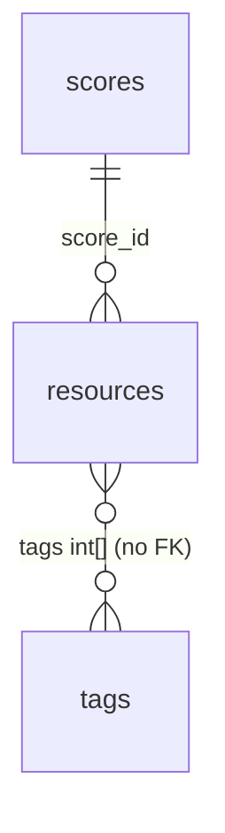

# End-state schema: Resources and Tags refactor

Companion to [resources-tags-refactor-plan.md](./resources-tags-refactor-plan.md). It shows the target PostgreSQL schema for every table the refactor touches. Table names follow the project's plural naming strategy.

Tables touched: `resources` (changed), `scores` (changed), `tags` (rewritten).

## Relationships

`resources.score_id` stays a plain integer column for now, as it is today. The FK to the Score entity is added when that relationship is established.

## Enum types

| Enum | Values |
|---|---|
| `category` | `food_access`, `housing`, `other` |
| `county` | unchanged (the 14 Massachusetts counties) |
| `response_time` | `same_day`, `1_3_days`, `1_week_plus`, `no_response` |
| `yes_no_maybe` | `yes`, `no`, `maybe` |
| `recommendation` | `strongly_recommend`, `recommend_minor_concerns`, `recommend_with_caution`, `not_recommended`, `needs_review` |
| `tag_group` | `population`, `intake_process`, `required_documentation`, `contact_method`, `red_flag`, `food_assistance_type`, `food_type`, `pricing`, `frequency`, `estimated_wait_time`, `housing_service_type`, `accessibility`, `cultural_competency`, `program_observation` |
| `tag_category` | `food_access`, `housing`, `other`, `common` |
| `public_field` | `website`, `phone`, `email`, `address` (the `resources` columns whose visibility can be chosen; adding a value means a new enum value) |

The old tag-level `category` enum (`food_service_type`, `food_type`, and so on) is replaced by `tag_category`.

## `resources`

| Column | Type | Null | Default | Notes |
|---|---|---|---|---|
| `resource_id` | `int` PK | no | generated | unchanged |
| `score_id` | `int` | no | | unchanged |
| `organization_name` | `varchar(255)` | no | | **renamed** from `name`; form: Organization Name |
| `program_name` | `varchar(255)` | no | | new |
| `category` | `category` enum | no | | **changed**: was `category[]` |
| `county` | `county` enum | no | | unchanged |
| `tags` | `int[]` | no | `{}` | unchanged, see note below the table |
| `zip_code` | `varchar(10)` | no | | unchanged |
| `address` | `varchar(255)` | yes | | unchanged |
| `phone` | `varchar(20)` | yes | | unchanged |
| `email` | `varchar(255)` | yes | | unchanged |
| `website` | `varchar(255)` | yes | | unchanged |
| `public_fields` | `public_field[]` | no | `{}` | the contact fields approved for the website; any field not listed is non-public |
| `eligibility` | `text` | yes | | unchanged, also holds the form's eligibility description |
| `review_status` | `review_status` enum | no | `pending_review` | renamed from `vetting_status`; values: `pending_review`, `approved_published`, `rejected`, `archived`, `sent_back_for_review`, `needs_changes` (the last two are both kept for now until one is chosen) |
| `last_verified_date` | `date` | no | | form: Date Information Verified |
| `completed_by` | `varchar(255)` | no | | the name of the logged-in user, copied once by the backend when the resource is created. It is not an FK, so deleting or renaming the user never changes or loses it |
| `outreach_date` | `date` | no | | new |
| `staff_contact_name` | `varchar(255)` | no | | new |
| `staff_contact_role` | `varchar(255)` | no | | new |
| `responsiveness` | `smallint` | no | | new, CHECK 1-5 |
| `response_time` | `response_time` enum | no | | new |
| `interaction_notes` | `text` | no | | new |
| `accessibility_notes` | `text` | no | | new |
| `program_notes` | `text` | yes | | new, food form Section 2 notes |
| `red_flag_concerns` | `text` | no | | new |
| `can_refer_directly` | `boolean` | no | | new |
| `has_referral_contact` | `boolean` | no | | new |
| `referral_contact` | `varchar(255)` | yes | | new |
| `provides_followup` | `boolean` | no | | new |
| `referral_realistic` | `yes_no_maybe` enum | no | | new |
| `referral_notes` | `text` | no | | new |
| `recommendation` | `recommendation` enum | no | | new |
| `strengths` | `text` | no | | new |
| `followup_needed` | `text` | no | | new |
| `needs_changes_notes` | `text` | yes | | new, reviewer notes when changes are requested |
| `submission_rejection_notes` | `text` | yes | | new, reviewer notes when a submission is rejected |
| `created_at` | `timestamptz` | no | `now()` | new |
| `updated_at` | `timestamptz` | no | `now()` | new |

Removed columns: `description`, `reviewer_notes`.

`tags` stays an `int[]` of tag IDs on the resource (`NOT NULL`, default `{}`), as it is today. It has no database foreign key, so `ResourcesService` checks that every ID exists in `tags`. Tags are deactivated with `is_active` rather than deleted, so IDs never dangle. Add a GIN index on `tags` for filtering.

Nullability follows the forms: questions marked required are `NOT NULL`, optional ones are nullable. `phone`, `email` and `website` stay nullable because they already are.

Indexes: `category`, `county`, `zip_code`.

## `scores` (changed)

| Column | Type | Null | Default | Notes |
|---|---|---|---|---|
| `score_id` | `int` PK | no | | unchanged |
| `overall_rating` | `smallint` | no | | new, CHECK 1-5 (1 = very poor, 5 = excellent); form: overall rating of the organization |

## Tag groups

A tag group is the `tag_group` enum on `tags.group`, not a table. Which groups allow only one answer (`frequency` and `estimated_wait_time`) is defined in code (`SINGLE_SELECT_TAG_GROUPS` in `apps/backend/src/tags/types.ts`). Adding a group means a new enum value in a migration.

The `accessibility`, `cultural_competency` and `program_observation` groups hold the Yes/No/Unsure tables: each row has a Yes tag, an "(unsure)" tag and an "(inapplicable)" tag, and "No" is represented by none being present. See section 4 of the plan.

## `tags` (rewritten)

| Column | Type | Null | Default | Notes |
|---|---|---|---|---|
| `tag_id` | `int` PK | no | generated | no longer hand-numbered |
| `category` | `tag_category` enum | no | | **changed**: values are now a resource category or `common` |
| `group` | `tag_group` enum | no | | the question or section the tag answers |
| `label` | `varchar(255)` | no | | |
| `slug` | `varchar(255)` | no | | |
| `sort_order` | `int` | no | `0` | |
| `is_active` | `boolean` | no | `true` | |
| `allows_free_text` | `boolean` | no | `false` | `true` on the seeded "Other" tag of each group. It is a template that custom tags are created from |
| `is_custom` | `boolean` | no | `false` | `true` on tag rows created from user-typed "Other" text |
| `other_text` | `text` | yes | | the typed text; set only when `is_custom` is true |

Constraints:
- unique `(group, slug)`;
- CHECK that `other_text` is not null exactly when `is_custom` is true.

Index: `category`. A custom tag copies the `category` of its template "Other" tag.

The old `category` values (`food_service_type` and so on) are replaced by `group` plus the new `category` meaning.

**Custom ("Other") tags:** when a user picks "Other" and types text, the service creates a tag row in that group with `label = 'Other'`, `is_custom = true`, `other_text` set to the text, and `slug = 'other-' + slugified text`. The new `tag_id` goes into `resources.tags`. If a custom tag with the same slug already exists in that group, it is reused instead of duplicated. Custom tags are ordinary tags: every retrieval method returns them, and `is_custom` lets a client tell them apart from the seeded options.

## Notes

- Rules that need data from another row (single-select groups, Yes/Unsure exclusivity) are enforced in `ResourcesService`, not by database constraints.
- A tag can attach to a resource only if its `category` is `common` or equals the resource's `category`. This is checked in the service.
