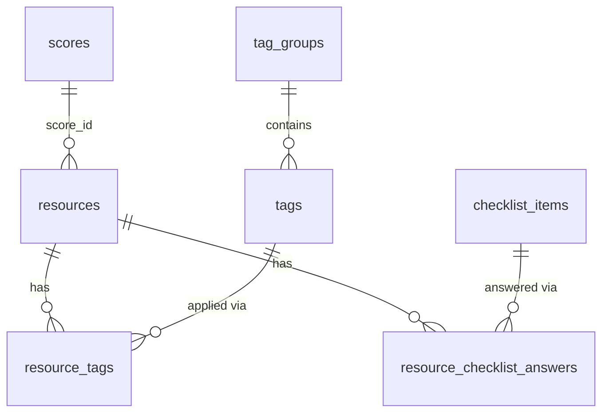

# End-state schema: Resources and Tags refactor

Companion to [resources-tags-refactor-plan.md](./resources-tags-refactor-plan.md). It shows the target PostgreSQL schema for every table the refactor touches. Table names follow the project's plural naming strategy.

Tables touched: `resources` (changed), `tags` (rewritten), `tag_groups` (new), `resource_tags` (new), `checklist_items` (new), `resource_checklist_answers` (new).

## Relationships

`resources.score_id` stays a plain integer column for now, as it is today. The FK to the Score entity is added when that relationship is established.

## Enum types

| Enum | Values |
|---|---|
| `category` | `food_access`, `housing`, `other` |
| `county` | unchanged (the 14 Massachusetts counties) |
| `response_time` | `same_day`, `1_3_days`, `1_week_plus`, `no_response` |
| `estimated_wait_time` | `same_day`, `1_7_days`, `1_4_weeks`, `1_3_months`, `over_3_months`, `unknown`, `other` |
| `yes_no_maybe` | `yes`, `no`, `maybe` |
| `recommendation` | `strongly_recommend`, `recommend_minor_concerns`, `recommend_with_caution`, `not_recommended`, `needs_review` |
| `tag_selection` | `single`, `multi` |
| `checklist_section` | `accessibility`, `cultural`, `observation` |
| `checklist_answer` | `yes`, `no`, `unsure`, `inapplicable` |

The old tag-level `category` enum (`food_service_type`, `food_type`, and so on) is dropped.

## `resources`

| Column | Type | Null | Default | Notes |
|---|---|---|---|---|
| `resource_id` | `int` PK | no | generated | unchanged |
| `score_id` | `int` | no | | unchanged |
| `name` | `varchar(255)` | no | | form: Organization Name |
| `program_name` | `varchar(255)` | no | | new |
| `category` | `category` enum | no | | **changed**: was `category[]` |
| `county` | `county` enum | no | | unchanged |
| `zip_code` | `varchar(10)` | no | | unchanged |
| `address` | `varchar(255)` | yes | | unchanged |
| `phone` | `varchar(20)` | yes | | unchanged |
| `email` | `varchar(255)` | yes | | unchanged |
| `website` | `varchar(255)` | yes | | unchanged |
| `public_fields` | `text[]` | no | `{}` | subset of `website`, `phone`, `email`, `address` |
| `eligibility` | `text` | yes | | unchanged, also holds the form's eligibility description |
| `vetting_status` | `varchar(255)` | no | | unchanged |
| `last_verified_date` | `date` | no | | form: Date Information Verified |
| `completed_by` | `varchar(255)` | no | | new, staff member completing the form |
| `outreach_date` | `date` | no | | new |
| `staff_contact_name` | `varchar(255)` | no | | new |
| `staff_contact_role` | `varchar(255)` | no | | new |
| `responsiveness` | `smallint` | no | | new, CHECK 1-5 |
| `response_time` | `response_time` enum | no | | new |
| `interaction_notes` | `text` | no | | new |
| `estimated_wait_time` | `estimated_wait_time` enum | no | | new |
| `accessibility_notes` | `text` | no | | new |
| `program_notes` | `text` | yes | | new, food form Section 2 notes |
| `red_flag_concerns` | `text` | no | | new |
| `can_refer_directly` | `boolean` | no | | new |
| `has_referral_contact` | `boolean` | no | | new |
| `referral_contact` | `varchar(255)` | yes | | new |
| `provides_followup` | `boolean` | no | | new |
| `referral_realistic` | `yes_no_maybe` enum | no | | new |
| `referral_notes` | `text` | no | | new |
| `recommendation` | `recommendation` enum | no | | new |
| `strengths` | `text` | no | | new |
| `followup_needed` | `text` | no | | new |
| `overall_rating` | `smallint` | no | | new, CHECK 1-5 |
| `needs_changes_notes` | `text` | yes | | new, reviewer notes when changes are requested |
| `submission_rejection_notes` | `text` | yes | | new, reviewer notes when a submission is rejected |
| `created_at` | `timestamptz` | no | `now()` | new |
| `updated_at` | `timestamptz` | no | `now()` | new |

Removed columns: `description`, `reviewer_notes`, `tags` (`int[]`).

Nullability follows the forms: questions marked required are `NOT NULL`, optional ones are nullable. `phone`, `email` and `website` stay nullable because they already are.

Indexes: `category`, `county`, `zip_code`.

## `tag_groups` (new)

| Column | Type | Null | Default | Notes |
|---|---|---|---|---|
| `group_id` | `int` PK | no | generated | |
| `key` | `varchar(255)` | no | | unique, e.g. `food_type` |
| `label` | `varchar(255)` | no | | display name |
| `selection` | `tag_selection` enum | no | `multi` | `single` allows at most one tag per resource |

Seeded groups: `population`, `intake_process`, `required_documentation`, `contact_method`, `red_flag`, `food_assistance_type`, `food_type`, `pricing`, `frequency` (single), `housing_service_type`.

## `tags` (rewritten)

| Column | Type | Null | Default | Notes |
|---|---|---|---|---|
| `tag_id` | `int` PK | no | generated | no longer hand-numbered |
| `group_id` | `int` | no | | FK to `tag_groups.group_id` |
| `label` | `varchar(255)` | no | | |
| `slug` | `varchar(255)` | no | | |
| `sort_order` | `int` | no | `0` | |
| `is_active` | `boolean` | no | `true` | |

Constraints: unique `(group_id, slug)`. Replaces the old `category` column with `group_id`.

## `resource_tags` (new)

| Column | Type | Null | Notes |
|---|---|---|---|
| `resource_id` | `int` | no | FK to `resources.resource_id`, `ON DELETE CASCADE` |
| `tag_id` | `int` | no | FK to `tags.tag_id`, `ON DELETE RESTRICT` |

Primary key: `(resource_id, tag_id)`. Index on `tag_id` for tag filtering.

## `checklist_items` (new)

| Column | Type | Null | Notes |
|---|---|---|---|
| `item_id` | `int` PK | no | generated |
| `key` | `varchar(255)` | no | unique, e.g. `ada_accessible` |
| `label` | `varchar(255)` | no | |
| `section` | `checklist_section` enum | no | |
| `allowed_answers` | `checklist_answer[]` | no | e.g. `{yes,no,unsure}`, or with `inapplicable` for cultural rows |
| `sort_order` | `int` | no | default `0` |

Seeded rows: 6 accessibility, 6 cultural, 5 food observation.

## `resource_checklist_answers` (new)

| Column | Type | Null | Notes |
|---|---|---|---|
| `resource_id` | `int` | no | FK to `resources.resource_id`, `ON DELETE CASCADE` |
| `item_id` | `int` | no | FK to `checklist_items.item_id`, `ON DELETE RESTRICT` |
| `answer` | `checklist_answer` enum | no | must be in the item's `allowed_answers` (checked in the service) |

Primary key: `(resource_id, item_id)`.

## Notes

- Rules that need data from another row (single-select groups, allowed answers) are enforced in `ResourcesService`, not by database constraints.
- Nothing is scoped by category. Any tag or checklist item can attach to any resource.
