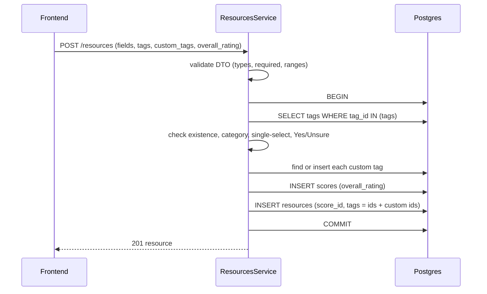

# Mock: submitting a resource from the frontend to the backend

Companion to [resources-tags-refactor-plan.md](./resources-tags-refactor-plan.md), [resources-tags-end-state-schema.md](./resources-tags-end-state-schema.md) and [resources-tags-form-field-mapping.md](./resources-tags-form-field-mapping.md). This is an illustration of the target behaviour, not implemented code. All IDs and values are made up.

## Recommendations (answers to the open design questions)

1. **The frontend sends a list of tag IDs, and the backend does not look tags up by name.** The form layout is hardcoded in the frontend, so the frontend does not need the tag endpoints to draw it. But it should **not hardcode numeric `tag_id` values**: they are serial, so a re-seed or a new migration can change them silently. Instead, the frontend hardcodes each option as a `(group key, slug)` pair, fetches the seeded tags once (`is_custom=false`), caches them, and builds a `slug -> tag_id` map. It sends the resulting IDs. The backend still *validates* the list, because it can't trust the client. That is one batched query (`WHERE tag_id IN (...)`), not a lookup per tag.
   - If you would rather hardcode IDs, the seed migration must insert explicit, never-reused `tag_id` values. That works but makes the seed file the single source of truth that must never be renumbered.
   - If you would rather the frontend send slugs and skip the map, the backend can resolve them in the same single query it already runs for validation, so it costs no extra lookup. The cost is that `tags` in the request would no longer match the `int[]` column.
2. **One `scores` row is created per resource, not a new table.** The backend creates it in the same request. The frontend never posts a score separately. The `overall_rating` from the form travels in the resource payload and is written to `scores.overall_rating`.
3. **Custom "Other" tags are created inside the same `POST /resources` request, not by a separate `POST /tags` call first.** The payload carries existing tag IDs in `tags` and the typed "Other" text in `custom_tags`. The backend creates (or reuses) the custom tag rows and adds their IDs to the resource, all in one transaction.

Why not post custom tags first (the alternative you raised):

| | Single request (recommended) | `POST /tags` first, then `POST /resources` |
|---|---|---|
| Atomicity | one transaction: if the resource fails, no custom tag is left behind | the tag exists even if the resource post then fails, so orphan custom tags pile up |
| Round trips | 1 | 1 per custom tag, plus 1 |
| New public endpoint | none | `POST /tags` has to be exposed to the frontend, so anyone can create tags |
| Validation | the service checks category, single-select and slug reuse in one place | split across two requests, and the resource request has to re-check anyway |
| Frontend work | send IDs plus `{ group_key, other_text }` | sequence the calls and handle partial failure |

If you prefer the two-step version, the change is small: add `POST /tags` that creates or reuses a custom tag and returns its row, and drop `custom_tags` from the resource payload. The orphan-tag and public-endpoint costs above are what you take on.

## Step 0: the frontend resolves its hardcoded options to tag IDs

The form's questions, options and layout are hardcoded in the frontend. Each option is declared by group key and slug, for example:

```ts
{ group: 'required_documentation', slug: 'proof-of-address', label: 'Proof of address' }
{ group: 'required_documentation', slug: 'other', label: 'Other', freeText: true }
```

Hardcoding means the frontend, not the database, decides which questions appear, their order, and which ones show a text box. So `sort_order` and `allows_free_text` on the tag are used by the backend, not needed to draw the form. The frontend still has to turn slugs into IDs, so it fetches only the **seeded (non-custom) tags**, once, and builds a map. Custom tags are never needed here, because they are created by the submission itself and are only referenced by ID afterwards. It needs both the form's own category and `common`.

```
GET /tags/category/food_access?is_custom=false   -> seeded tags for the food form only
GET /tags/category/common?is_custom=false        -> seeded tags shared by both forms
```

`is_custom` is an **optional** query parameter. Without it, the endpoint still returns every tag, custom ones included, as agreed earlier. The frontend opts in to the filter. The same optional parameter should be accepted by `GET /tags/group/:groupKey`.

Each tag comes back like this:

```json
{
  "tag_id": 41,
  "category": "common",
  "group_id": 3,
  "label": "Other",
  "slug": "other",
  "sort_order": 99,
  "is_active": true,
  "allows_free_text": true,
  "is_custom": false,
  "other_text": null
}
```

The frontend builds `slug -> tag_id` per group from this response and keeps the chosen `tag_id` values as the user answers. Its hardcoded definition says which groups are single-select and which options take free text, and the backend enforces the same rules. For the Yes / Unsure tables it keeps the Yes tag, the "(unsure)" tag, or neither for "No".

### Caching the tag map

Seeded tags only change through a migration, so the map is cached and reused instead of refetched on every load.

- **Where:** persistent browser storage (for example `localStorage`), under a key that is not tied to the user.
- **Across login and logout:** the cache is not cleared on logout and is not keyed by user. The data is the same for everyone and holds nothing personal.
- **When to refetch:** only when the cache is missing (first visit, cleared storage), or when validation says it is stale (below).
- **Stale cache:** if a later migration adds, renames or deactivates a seeded tag, a cached map would silently miss it. Two safeguards:
  - store a `tagsVersion` next to the map and bump the frontend's expected version whenever a seed migration changes tags, so a mismatch forces a refetch;
  - treat a backend rejection of a tag ID (unknown, inactive or wrong category) as a signal to clear the cache, refetch, and retry once.
- **Custom tags are not cached.** They are returned by the submission response and by `findByIds` when a saved resource is displayed.

Two consequences of a hardcoded form:
- **Drift.** If a slug in the frontend is missing from the map (seed changed, tag deactivated), the frontend should fail loudly instead of silently dropping the answer, and refetch once before failing. The backend's existence and `is_active` checks are the safety net.
- **Adding or changing an option** needs both a seed migration and a frontend change (see [adding-a-resource-category.md](./adding-a-resource-category.md)).

## Step 1: the request

`POST /resources` with the food form's answers. `tags` holds IDs of existing tags. `custom_tags` holds the "Other" text the user typed.

```json
{
  "category": "food_access",
  "organization_name": "Greater Boston Food Pantry",
  "program_name": "Weekly Pantry",
  "website": "https://example.org",
  "phone": "617-555-0100",
  "email": "pantry@example.org",
  "address": "12 Example St",
  "zip_code": "02115",
  "county": "suffolk",
  "public_fields": ["website", "phone"],
  "outreach_date": "2026-10-20",
  "last_verified_date": "2026-10-22",
  "staff_contact_name": "Sam Lee",
  "staff_contact_role": "Program Manager",
  "eligibility": "Residents of Boston, photo ID required.",
  "responsiveness": 4,
  "response_time": "1_3_days",
  "interaction_notes": "Replied by email within two days.",
  "accessibility_notes": "Near the Orange Line.",
  "program_notes": "Open Saturdays only.",
  "red_flag_concerns": "Limited hours.",
  "can_refer_directly": true,
  "has_referral_contact": true,
  "referral_contact": "Sam Lee",
  "provides_followup": false,
  "referral_realistic": "maybe",
  "referral_notes": "Email works best.",
  "recommendation": "recommend_minor_concerns",
  "strengths": "Fresh produce, welcoming staff.",
  "followup_needed": "Confirm holiday hours.",
  "overall_rating": 4,
  "tags": [12, 15, 33, 41, 58, 60],
  "custom_tags": [
    { "group_key": "required_documentation", "other_text": "Letter from landlord" }
  ]
}
```

`review_status`, `score_id`, `submitted_by_user_id` (taken from the logged-in user), `created_at` and `updated_at` are not sent. The backend sets them. `needs_changes_notes` and `submission_rejection_notes` are optional and left out.

## Step 2: what the backend does

All of this runs in one database transaction.



1. **DTO validation.** Required fields, enum values, `responsiveness` and `overall_rating` in 1-5, `public_fields` values in the `public_field` enum.
2. **Load the submitted tags in one query.** `SELECT * FROM tags WHERE tag_id IN (12, 15, 33, 41, 58, 60)`.
3. **Check them.**
   - Every ID exists and is active.
   - Each tag's `category` is `common` or equals the resource's `category` (`food_access`).
   - No single-select group (`frequency`, `estimated_wait_time`) has more than one tag.
   - No Yes/Unsure/Inapplicable row has more than one of its tags.
4. **Handle custom tags.** For each entry in `custom_tags`:
   - look up the group by `group_key` and its seeded "Other" template tag (`allows_free_text = true`); a group with no such tag is rejected;
   - build the slug `other-letter-from-landlord`;
   - if a tag with that `(group_id, slug)` exists, reuse it; otherwise insert a new tag row with `is_custom = true`, `other_text = 'Letter from landlord'`, and the template's `category`;
   - add the resulting `tag_id` to the list and re-run the category and single-select checks on the combined list.
5. **Create the score.** Insert a `scores` row with `overall_rating = 4`. This gives `score_id = 7`.
6. **Create the resource.** Insert into `resources` with `score_id = 7`, `review_status` set to `pending_review`, and `tags = [12, 15, 33, 41, 58, 60, 102]` (the new custom tag is `102`).
7. **Commit.** If any step fails, everything rolls back, including the custom tag and the score.

The score is created before the resource because `resources.score_id` is `NOT NULL`. This needs two changes from today: `Score.score_id` must become a generated key (it is a hand-set `PrimaryColumn` now), and the current default of `score_id = 0` in `create()` goes away.

## Step 3: the response

`201 Created` with the saved resource. The tag list is IDs only. The frontend can resolve labels with the existing `POST /tags/findByIds`, and the score with `GET /score/findOneById/7`.

```json
{
  "resource_id": 25,
  "score_id": 7,
  "category": "food_access",
  "organization_name": "Greater Boston Food Pantry",
  "review_status": "pending_review",
  "tags": [12, 15, 33, 41, 58, 60, 102],
  "created_at": "2026-10-29T12:00:00Z",
  "updated_at": "2026-10-29T12:00:00Z"
}
```

(other fields from the request are echoed back)

## Failure examples

| Submission | Response |
|---|---|
| `tags` contains `9999`, which doesn't exist | `400`, unknown tag ID 9999 |
| `category` is `food_access` but a `housing` tag is included | `400`, tag not valid for this category |
| Two tags in the `frequency` group | `400`, group allows only one selection |
| Both "ADA accessible" and "ADA accessible (unsure)" | `400`, conflicting answers for one row |
| `custom_tags` names a group with no "Other" option | `400`, group does not allow free text |
| `overall_rating` is `6` | `400`, rating must be 1-5 |
| Any failure after the custom tag or score insert | `500`, rolled back: no tag, score or resource saved |

## Reusing a custom tag

A second pantry also types "Letter from landlord" under required documentation. The slug matches the existing tag `102`, so no new row is created. Both resources point at `102`. A different spelling such as "Landlord letter" creates a separate tag, which is a known limit of slug matching.

## Notes and open points

- **Editing** a resource (`PATCH /resources/:id`) follows the same rules: the frontend sends the full `tags` list plus any new `custom_tags`, and `overall_rating` updates the existing `scores` row instead of creating one.
- **Scoring is one row per resource.** If scoring should later allow several scores per resource, the FK direction would have to change. For now `resources.score_id` points at one `scores` row.
- **Request field name.** The request uses `tags` for IDs to match the column. `custom_tags` is request-only and is never stored on the resource.
- **Custom tags and `is_active`.** A reused custom tag must still be active. Deactivating a custom tag means resources already using it keep it, but new submissions create a fresh one.
